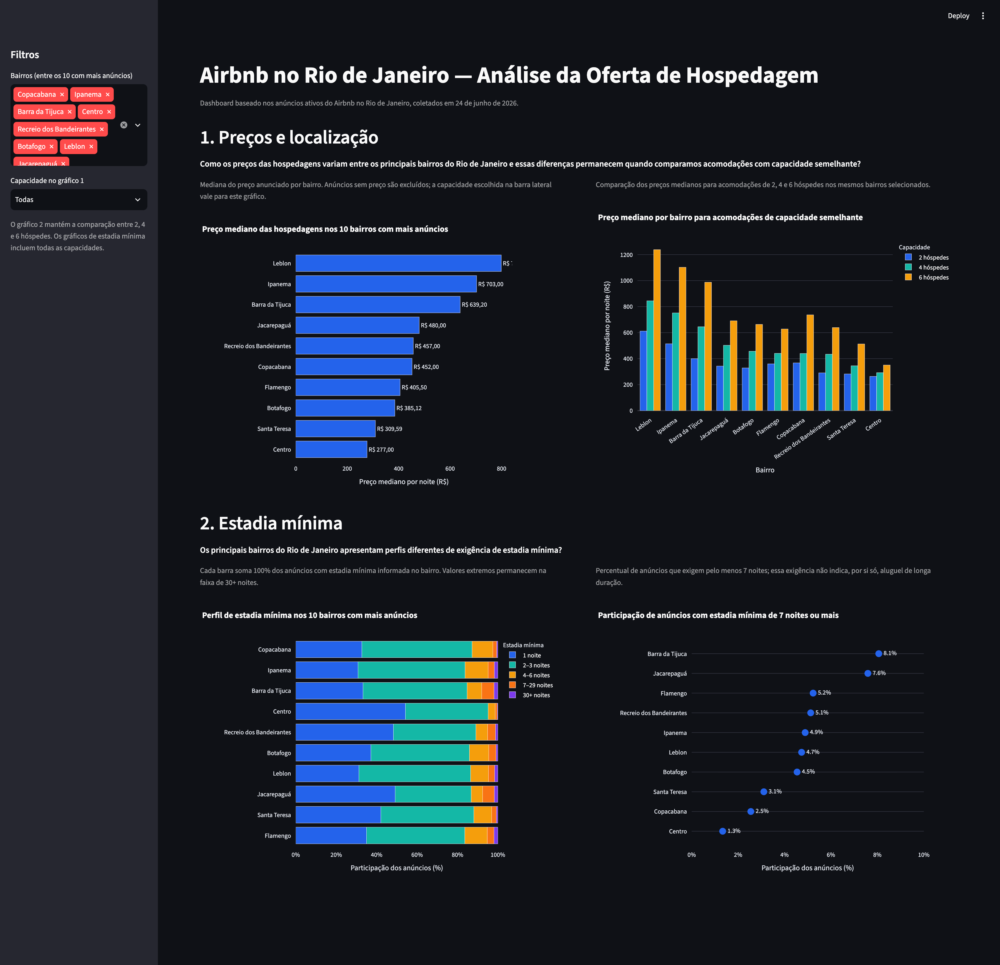

## Interactive Dashboard

**[View Live Dashboard](https://airbnbrio.streamlit.app/)**

# Airbnb Rio de Janeiro | Data Analysis

An exploratory data analysis of Airbnb listings in Rio de Janeiro, Brazil, examining accommodation prices, neighborhood differences, guest capacity, and minimum stay requirements.

Developed as part of **IA001 – Data Analysis and Visualization**, within the Advanced Artificial Intelligence postgraduate program at **UFRGS**.

## Overview

Using data from [Inside Airbnb](https://insideairbnb.com/), the project explores two main questions:

1. **Pricing and location:** How do accommodation prices vary across Rio de Janeiro's most active neighborhoods, and how does guest capacity affect these differences?
2. **Minimum stay requirements:** How do minimum stay policies differ between neighborhoods, and what proportion of listings require longer stays?

The analysis is conducted in a Jupyter Notebook, with the main findings presented through an interactive Streamlit dashboard.

The dashboard provides interactive visualizations of median accommodation prices, comparisons by guest capacity, and minimum stay distributions across the 10 neighborhoods with the most listings.



## Running Locally

```bash
git clone https://github.com/lucao-py/postgrad-ia001-test-01.git
cd postgrad-ia001-test-01

pip install -r requirements.txt
streamlit run dashboard.py
```
